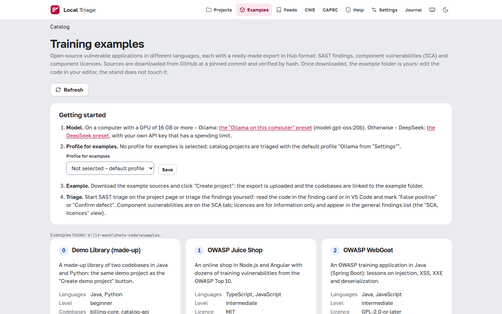
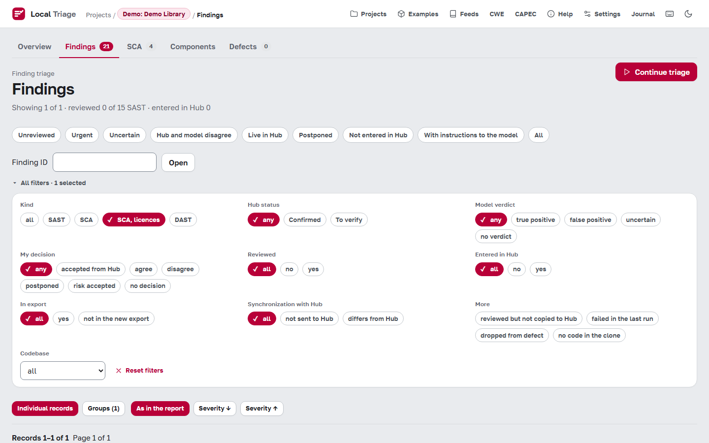

# Local Triage – training stand

**English** · [Русский](README.ru.md)

## What it is

Security analyzers scan code and flag suspicious places: a possible SQL injection, a password written straight into
the code, an outdated library with a known vulnerability. There are usually hundreds of such findings, and some of them
are false. Someone has to go through each one: look at the code, decide whether the problem is real and record the
decision. This work is called **triage**.

Local Triage is a training stand for learning it. It comes with ten open training applications that contain deliberate
vulnerabilities, plus ready-made scan results for them. You open a finding, read the code and the language model's
hint, and make the decision yourself: "False positive" or "Confirm defect".

What you triage on the stand:

- **SAST** – findings in the source code (injections, cross-site scripting, path traversal, secrets in code and more);
- **SCA** – vulnerabilities in third-party components the application uses (for example, an old library version);
- **component licences** – components whose licence terms have to be taken into account.

Everything runs on your computer, in the browser. The stand installs with one command, no Docker needed.

The interface is in English by default. Russian is available too: open **Settings**, choose **Русский** under
**Interface language** and press **Save language**. The choice is saved in the stand's database.

## Before you start

1. **A computer** with Windows 10 or 11 (64-bit) or Linux. The stand has not been tested on macOS. Windows on ARM
   processors is not supported.
2. **Node.js 20 or newer.**

   On Windows, Node.js installs with one PowerShell command, no need to visit the website:

   ```powershell
   winget install OpenJS.NodeJS.LTS
   ```

   If Windows asks for permission to make changes, answer "Yes". After the installation, close the terminal window and
   open a new one, otherwise the `node` and `npm` commands will not be found. To check: `node -v` should print v20 or
   higher. If you already have an older Node.js, update it with one command too: `winget upgrade OpenJS.NodeJS.LTS`.
   If winget is disabled on the computer, download the LTS installer from https://nodejs.org/ and run it with the
   default settings.

3. **About 2 GB of free disk space and internet access** on the first start: the stand downloads Python and everything
   else it needs by itself.

## Installation and first start

1. Open a terminal: PowerShell on Windows (press Start and type "PowerShell"), Terminal on Linux.
2. Type the command and press Enter:

   ```
   npx local-triage
   ```

   If you see the question `Ok to proceed? (y)`, press `y` and Enter.

3. Wait a few minutes. The window shows lines about the installation progress. When everything is ready, the line
   "The stand is running: http://127.0.0.1:8765/" appears and the browser opens the stand. If port 8765 is busy, the
   stand takes the next free one – the number will be different, so open the address from that line. If the browser
   does not open, copy the address into the browser yourself.
4. **Keep the terminal window open while you work.** The stand runs in it. Close the window and the stand stops.
5. When you finish, press Ctrl+C in the terminal window or just close it. All your decisions are saved.

Next time, start the stand with the same `npx local-triage` command: it takes a few seconds.

Terminal messages are in English by default; `npx local-triage --lang ru` shows them in Russian.

## First steps on the stand

### 1. Connect a language model

The model reads the code of a finding and suggests its verdict. You can also work without a model: you make the
decisions, just without the hint.

In the stand, open the **Examples** tab, the **Getting started** block, and choose one of two options.

- **Ollama – a model on your computer.** Suitable if your graphics card has 16 GB of memory or more. The code stays on
  your computer.
  1. Install Ollama from https://ollama.com.
  2. In a terminal, run `ollama pull gpt-oss:20b` – the model is downloaded once, it takes several gigabytes.
  3. In the stand, click the "Ollama on this computer" preset link, then **Check** and **Save**.
- **DeepSeek – a model on the internet.** Suitable for any computer. You need your own DeepSeek API key
  (https://platform.deepseek.com); requests to the model are paid.
  1. Get a key in your DeepSeek account and set a spending limit there right away.
  2. In the stand, click the DeepSeek preset link: the address, the model and the **Advanced** section (reasoning,
     limits, search) are already filled in with recommended values, and every field has a hint. If you created a
     DeepSeek profile earlier, open it, expand **Advanced** and press **Fill in recommended DeepSeek values**.
  3. Paste the key into the **Key** field, press **Check**, then **Save**.

  Code goes to DeepSeek only for a project marked "code is not secret". Projects of the training examples get this
  mark right away: the ten downloadable examples have open code, and Demo Library is made up. You can remove the mark
  in **Project settings**. The data is processed by the provider in China.

When the interface is in English, the model writes its explanations in English as well.


In the same block, choose the saved profile in the **Profile for examples** field and press **Save** – then the model
connects by itself to every new project created from the ten training applications. Demo Library uses the default
profile: a different profile is chosen in its project settings. If the stand is started with `--local-only`, an
external profile (DeepSeek) is not assigned to new projects – they get the default profile; if that one is external
too, choose Ollama for triage in the project settings.

### 2. Choose an example and create a project

The **Examples** tab has cards for the training applications: OWASP Juice Shop, OWASP WebGoat, PyGoat, OWASP NodeGoat,
DVWA, OWASP RailsGoat, DVGA, go-test-bench, VulnerableLightApp, OWASP crAPI. There is also a small made-up example,
Demo Library – a good place to start.



1. After the first start, the stand downloads the source code of the examples from GitHub by itself. Wait until the
   card shows that the example is downloaded. If it says "Not downloaded", press **Download**.
2. Press **Create project**. The stand loads the example's findings and opens the project page.

Each example has one project. Once it is created, the card shows **Open project** instead of **Create project**: your
decisions on the findings are kept in it.

### 3. Triage the findings

1. On the project page, open the **Findings** tab – the list of all project findings; SAST findings in the code are
   under the **Kind** filter set to "SAST" (or the **Unreviewed** selection).
2. Open a finding. The card shows the rule that fired, the vulnerability class (CWE) with a link to its description,
   and the code around the flagged line. **Open in VS Code** opens the file at that line if the VS Code editor is
   installed.
3. Press **Analyze with the model** to get a hint, or work it out yourself.
4. Choose a decision: **False positive** (with a short reason) or **Confirm defect**.
5. Component vulnerabilities are on the **SCA** tab; licence findings are in the general findings list, kind
   "SCA, licences".




Detailed help and a glossary are behind the **Help** button in the top bar of the stand.

## Where the files are

The stand creates two folders:

- **The code folder** – the `local-triage` folder in your home folder: `%USERPROFILE%\local-triage` on Windows,
  `~/local-triage` on Linux. It holds the source code of the examples. You can open this folder in VS Code and change
  the code: the stand does not touch your edits. To get a clean copy of an example, press **Download again** on its
  card – the new copy appears next to the old one, and the old one stays.
- **The service folder** – `%LOCALAPPDATA%\local-triage` on Windows, `~/.local/share/local-triage` on Linux. It holds
  the database with your decisions, Python and the logs. Nothing in it needs changing.

The `npx local-triage --where` command shows both folders with full paths. On Windows, a path like
`%USERPROFILE%\local-triage` can be pasted into the File Explorer address bar to open the folder.

## By design

This behaviour may look like a bug, but it is intentional.

- **The model's analysis details are collapsed.** The model's verdict, its confidence and the summary are always
  visible at the top of the card. Only the **Analysis details** section is collapsed – what the code does, why the
  verdict is what it is, the data path. Expand it once and the stand remembers: it stays open in other cards too.
- **"Re-analyze with a model" and "Move to archive" are inside collapsed blocks.** These are rare actions: a repeated
  analysis keeps the model busy for a long time (the "Re-analyze with a model" block on the finding card), and the
  archive removes a project from the list (the **Project settings** block). They sit in collapsed blocks so that
  nobody presses them by accident; archiving asks for confirmation first. Deleting a project is there as well, in
  **Project settings**, and leads to a separate confirmation page.
- **An example cannot have a second project.** Each example has one project, which keeps your decisions. Once the
  project exists, the example card shows **Open project**. For a clean copy of the code, use **Download again** – your
  decisions are not lost.
- **Vulnerability feeds load one at a time.** While one archive is being processed, the **Upload** buttons on the other
  cards are unavailable. Wait until it is done and load the next one.
- **GitHub shows hundreds of vulnerability alerts.** They refer to the dependency snapshots of the training examples
  (`examples/catalog/*/inputs/lock`): Juice Shop, WebGoat and the other applications are vulnerable on purpose, and
  students learn to triage SCA findings on these snapshots. The stand itself does not install or run these
  dependencies.
- **After the stand is killed in Task Manager, the next start waits.** The stand prints "A previous app process still
  holds the data folder – waiting for its lock mark to expire…" and continues by itself in less than a minute,
  connecting to its database. No decisions are lost. The normal way to stop it is Ctrl+C in the stand window or
  closing the window.
- **Earlier decisions and model answers keep their language.** Switching the interface language does not translate
  what is already saved. To get a model answer in the new language, analyze the finding with the model again.

## If something goes wrong

- **The `npx` command is not found.** Node.js is not installed, or the terminal was opened before the installation.
  Install Node.js with `winget install OpenJS.NodeJS.LTS`, close the terminal and open it again.
- **The stand is already running in another window.** Then `npx local-triage` just opens the browser with the running
  stand: a second stand is not needed.
- **An example does not download.** Direct internet access to github.com is required. Press **Retry** on the card.
- **Environment check:** `npx local-triage --doctor` checks the environment and prints the result.
- The logs are in the `logs` folder of the service folder – you can attach them to a question to your teacher.

## Command options

Usually no options are needed. They go after the command, for example `npx local-triage --no-open`.

| Option | What it does |
|---|---|
| `--no-open` | do not open the browser on start |
| `--port 8800` | open the stand on this port; without it the stand takes the first free port starting from 8765 |
| `--local-only` | forbid models on the internet (DeepSeek): only models on your computer and on the local network work |
| `--lang ru` | terminal messages in Russian (`en` – in English, the default) |
| `--where` | show where the stand's folders are |
| `--doctor` | check the environment |
| `--new-database` | start with a clean database; the previous one is kept in the service folder, in `pg\backups` |
| `--home FOLDER` | keep the service files in another folder – this gives a separate stand with its own database; use a new empty folder |
| `--code-dir FOLDER` | a different code folder; set on the first start and not changed afterwards |
| `--version`, `--help` | version and short help |

## What the stand does not do

- **It does not send decisions to external systems.** In organisations, the results of all analyzers are collected in
  an ASOC system (Application Security Orchestration and Correlation). One such system is AppSec.Hub, and the Local
  Triage application can send decisions to it. The training stand has no such connection: all decisions stay only in
  the database on your computer. The example findings are prepared in the AppSec.Hub export format, which is why the
  program mentions "Hub" and "Transfer to Hub (ASOC)".
- **It does not work through a proxy server.** The stand connects to DeepSeek and to GitHub (example downloads)
  directly.
- **On Linux it does not start as root** – start it as a regular user.

## Restore the database from before the update

When a new version of the stand comes out, it may update the database structure. Before that, the stand saves a copy of
the previous database in the `pg\backups\<copy name>` folder of the service folder. Next to it are the file
`<copy name>.json` (the `npm_version` field holds the stand version that worked with this database) and the file
`<copy name>.pg.pw` – the password of this database. To go back to the copy:

1. Close the stand window.
2. In the service folder, rename the `pg\data` folder to `pg\data-new` and the `secrets\pg.pw` file to
   `secrets\pg.pw-new`.
3. Rename the copy folder to `pg\data`, and copy its password file `<copy name>.pg.pw` to `secrets\pg.pw`.
4. Start the stand version given in the `npm_version` field: `npx local-triage@<version>`. If it says `unknown`, you
   can find the version in the `logs\supervisor-<date>.log` log for the day this database was in use. If the previous
   version cannot be started, the new version updates the database again, and a copy from before the update is saved
   again.

Copies made by the `--new-database` option are named `<time>-replaced-v<version>`: the database and the password are
inside the copy folder (`data` and `pg.pw`), and the version is in the `<copy name>.json` file.

## How to remove the stand

1. Close the stand window.
2. Find the service folder: `npx local-triage --where`. If it contains a `uv` folder, the stand installed Python with
   the uv program, and the downloaded Python and the uv cache are outside the service folder. Before deleting the
   service folder, check where they are: run `uv\uv.exe python dir` and `uv\uv.exe cache dir` from the service folder
   (`uv/uv` on Linux). Delete those folders if you no longer need uv. If there is no `uv` folder, the stand installed
   Python without uv and this step is not needed.
3. Delete the service folder.
4. Delete the code folder only if it holds none of your work.

## For those who want to look at the stand's code

The source code is at https://github.com/pikov-vitaliy/local-triage-for-students. To run the stand from source you
also need Git:

```
git clone https://github.com/pikov-vitaliy/local-triage-for-students.git
cd local-triage-for-students
npm install
npx local-triage
```

The sources of the training examples and their licences are in `examples/catalog/NOTICE.md`.
