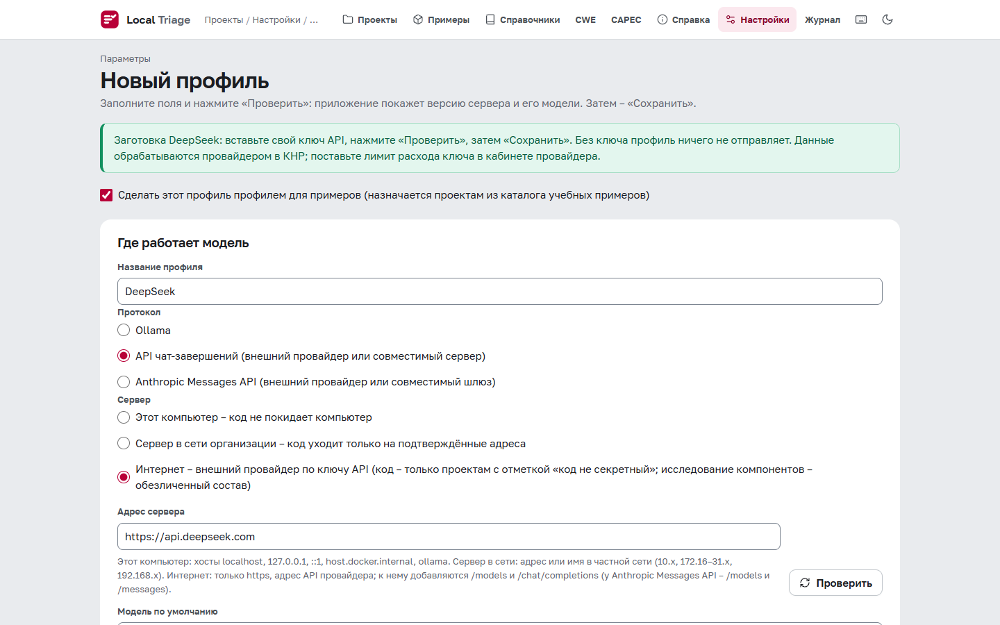
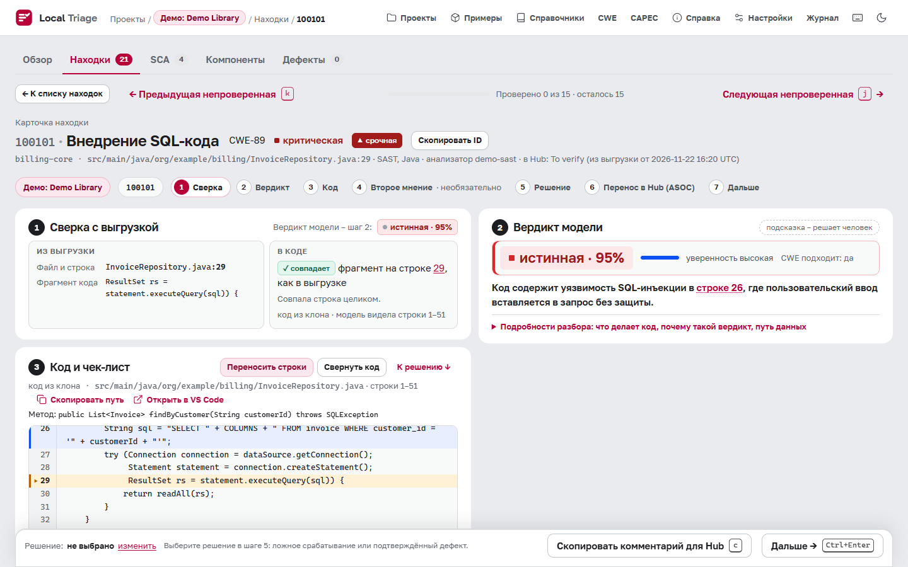

# Локальный триаж – учебный стенд

## Что это

Программы проверки безопасности кода (анализаторы) находят в нём подозрительные места: возможную SQL-инъекцию,
пароль, записанный прямо в коде, устаревшую библиотеку с известной уязвимостью. Таких находок обычно сотни, и часть из
них ложные. Человек должен разобрать каждую: посмотреть код, понять, есть ли настоящая проблема, и записать решение.
Этот разбор называется **триажем**.

Учебный стенд «Локальный триаж» – приложение, на котором этому учатся. В нём уже есть десять открытых учебных
приложений с намеренно оставленными уязвимостями и готовые результаты их проверки. Вы открываете находку, смотрите код,
читаете подсказку языковой модели и принимаете решение сами: «ложное срабатывание» или «подтверждаю дефект».

Что разбирается на стенде:

- **SAST** – находки в исходном коде (инъекции, межсайтовый скриптинг, обход пути, секреты в коде и другие);
- **SCA** – уязвимости сторонних компонентов, которые использует приложение (например, старая версия библиотеки);
- **лицензии компонентов** – компоненты, условия лицензии которых нужно учитывать.

Всё работает на вашем компьютере, в браузере. Стенд ставится одной командой, Docker не нужен.

## Что нужно заранее

1. **Компьютер:** Windows 10 или 11 (64-разрядная) или Linux. На macOS стенд не проверялся. Windows на процессорах ARM
   не поддерживается.
2. **Node.js версии 20 или новее.**

   На Windows Node.js ставится одной командой в PowerShell, на сайт заходить не нужно:

   ```powershell
   winget install OpenJS.NodeJS.LTS
   ```

   Если Windows спросит разрешение на изменения, ответьте «Да». После установки закройте окно терминала и откройте
   новое, иначе команды `node` и `npm` не найдутся. Проверка: `node -v` – должно быть v20 или больше. Node.js уже
   стоит, но старый – обновите его так же одной командой: `winget upgrade OpenJS.NodeJS.LTS`. Если winget на
   компьютере отключён, скачайте установщик LTS с https://nodejs.org/ и пройдите его с настройками по умолчанию.

3. **Около 2 ГБ свободного места и интернет** при первом запуске: стенд сам скачает Python и всё, что ему нужно.

## Установка и первый запуск

1. Откройте терминал: на Windows – PowerShell (нажмите «Пуск», наберите «PowerShell»), на Linux – «Терминал».
2. Введите команду и нажмите Enter:

   ```
   npx local-triage
   ```

   Если появится вопрос `Ok to proceed? (y)`, нажмите `y` и Enter.

3. Подождите несколько минут. В окне будут появляться строки о ходе установки. Когда всё будет готово, появится строка
   «Стенд работает: http://127.0.0.1:8765/» и откроется браузер со страницей стенда. Если порт 8765 занят, стенд
   сам возьмёт следующий свободный – номер будет другим, открывайте адрес из этой строки. Если браузер не открылся,
   скопируйте этот адрес в браузер сами.
4. **Не закрывайте окно терминала, пока работаете.** В нём работает стенд. Закрыли окно – стенд остановился.
5. Закончили работу – нажмите в окне терминала Ctrl+C или просто закройте окно. Все ваши решения сохраняются.

В следующий раз запускайте стенд той же командой `npx local-triage`: запуск займёт несколько секунд.

## Первые шаги в стенде

### 1. Подключите языковую модель

Модель читает код находки и предлагает свой вердикт. Без модели тоже можно работать: решения принимаете вы, просто
без подсказки.

Откройте в стенде вкладку **«Примеры»**, блок **«Начало работы»**, и выберите один из двух вариантов.

- **Ollama – модель на вашем компьютере.** Подходит, если у видеокарты 16 ГБ памяти или больше. Код никуда не уходит.
  1. Установите Ollama с https://ollama.com.
  2. В терминале выполните `ollama pull gpt-oss:20b` – модель скачивается один раз, это несколько гигабайт.
  3. В стенде нажмите ссылку «заготовка «Ollama на этом компьютере»», затем «Проверить» и «Сохранить».
- **DeepSeek – модель в интернете.** Подходит для любого компьютера. Нужен свой ключ API DeepSeek
  (https://platform.deepseek.com), запросы к модели платные.
  1. Получите ключ в кабинете DeepSeek и сразу поставьте там лимит расхода.
  2. В стенде нажмите ссылку «заготовка DeepSeek»: адрес, модель и раздел «Дополнительно» (рассуждение, пределы,
     поиск) уже заполнены рекомендуемыми значениями, у каждого поля – подсказка. Если профиль DeepSeek создан раньше,
     откройте его, раскройте «Дополнительно» и нажмите «Подставить рекомендуемые значения DeepSeek».
  3. Вставьте ключ в поле «Ключ», нажмите «Проверить», затем «Сохранить».

  Код уходит в DeepSeek только у проекта с отметкой «код не секретный». Проекты учебных примеров получают её сразу:
  у десяти скачиваемых примеров код открытый, у Demo Library – выдуманный. Снять отметку можно в «Параметрах
  проекта». Данные обрабатываются провайдером в Китае.




В том же блоке выберите сохранённый профиль в поле **«Профиль для примеров»** и нажмите «Сохранить» – тогда модель
будет подключаться к каждому новому проекту из десяти учебных приложений сама. Demo Library работает с профилем по
умолчанию: другой профиль выбирается в параметрах её проекта. Если стенд запущен с `--local-only`, внешний профиль
(DeepSeek) новым проектам не назначается – они получают профиль по умолчанию; если и он внешний, выберите для разбора
Ollama в параметрах проекта.

### 2. Выберите пример и создайте проект

На вкладке «Примеры» – карточки учебных приложений: OWASP Juice Shop, OWASP WebGoat, PyGoat, OWASP NodeGoat, DVWA,
OWASP RailsGoat, DVGA, go-test-bench, VulnerableLightApp, OWASP crAPI. Есть и небольшой выдуманный пример Demo Library –
с него удобно начать.


1. После первого запуска стенд сам скачивает исходный код примеров с GitHub. Подождите, пока на карточке появится
   «Скачан». Если написано «Не скачан», нажмите «Скачать».
2. Нажмите **«Создать проект»**. Стенд загрузит находки примера и откроет страницу проекта.

У каждого примера один проект. Когда он уже создан, на карточке вместо «Создать проект» стоит «Открыть проект»: ваши
решения по находкам хранятся в нём.

### 3. Разберите находки

1. На странице проекта откройте вкладку **«Находки»** – общий список находок проекта; находки SAST в коде – фильтр
   «Вид»: «SAST» (или подборка «Непроверенные»).
2. Откройте находку. В карточке – правило, которое сработало, класс уязвимости (CWE) со ссылкой на описание и код
   вокруг строки срабатывания. Кнопка **«Открыть в VS Code»** открывает файл на нужной строке, если установлен
   редактор VS Code.
3. Нажмите «Разобрать моделью», чтобы получить подсказку, или разберитесь сами.
4. Выберите решение: **«Ложное срабатывание»** (с короткой причиной) или **«Подтверждаю дефект»**.
5. Уязвимости компонентов – на вкладке **«SCA»**, находки о лицензиях – в общем списке находок, вид «SCA, лицензии».





Подробная справка и словарь терминов – кнопка **«Справка»** в верхней строке стенда.

## Где лежат файлы

Стенд создаёт две папки:

- **Папка кода** – папка `local-triage` в вашей личной папке: `%USERPROFILE%\local-triage` на Windows,
  `~/local-triage` на Linux. Здесь лежит исходный код
  примеров. Эту папку можно открыть в VS Code и менять код: стенд ваши правки не трогает. Чтобы получить чистую копию
  примера, нажмите на его карточке «Скачать заново» – новая копия появится рядом, старая останется.
- **Служебная папка** – `%LOCALAPPDATA%\local-triage` на Windows, `~/.local/share/local-triage` на Linux. Здесь база с вашими решениями, Python и журналы. Менять в ней ничего не нужно.

Команда `npx local-triage --where` покажет обе папки полными путями. На Windows путь вида `%USERPROFILE%\local-triage`
можно вставить в адресную строку Проводника – откроется нужная папка.

## Так задумано

Это поведение может показаться ошибкой, но оно намеренное.

- **Подробности разбора модели свёрнуты.** Вердикт модели, её уверенность и итог всегда видны вверху карточки. Свёрнут только раздел «Подробности разбора» – что делает код, почему такой вердикт, путь данных. Раскройте его один раз, и стенд запомнит: дальше он будет открыт и в других карточках.
- **«Пересмотреть моделью» и «Убрать в архив» спрятаны в свёрнутых блоках.** Это редкие действия: повторный разбор надолго занимает модель (блок «Пересмотреть моделью» в карточке находки), архив убирает проект из списка (блок «Параметры проекта»). Чтобы их не нажали случайно, они лежат в свёрнутых блоках; архив перед действием спрашивает подтверждение. «Удалить проект» – там же, в «Параметрах проекта», и ведёт на отдельную страницу подтверждения.
- **У примера нельзя создать второй проект.** У каждого примера один проект: в нём хранятся ваши решения. Когда проект создан, на карточке примера стоит «Открыть проект». Чистая копия кода – кнопка «Скачать заново», решения при этом не пропадают.
- **Справочники загружаются по одному.** Пока разбирается один архив, кнопки «Загрузить» в других карточках недоступны. Дождитесь строки «Готово» и загрузите следующий.
- **GitHub показывает сотни предупреждений об уязвимостях.** Они относятся к снимкам зависимостей учебных примеров (`examples/catalog/*/inputs/lock`): Juice Shop, WebGoat и другие приложения уязвимы нарочно, по этим снимкам студенты учатся разбирать находки SCA. Сам стенд эти зависимости не устанавливает и не запускает.
- **После снятия стенда через Диспетчер задач следующий запуск ждёт.** Стенд пишет «Прежний процесс приложения ещё держит папку данных – жду…» и меньше чем через минуту продолжает сам, подключаясь к своей базе. Решения не теряются. Обычная остановка – Ctrl+C в окне стенда или закрыть окно.

## Если что-то пошло не так

- **Команда `npx` не найдена.** Node.js не установлен или терминал открыт до установки. Установите Node.js командой
  `winget install OpenJS.NodeJS.LTS`, закройте
  терминал и откройте его снова.
- **Стенд уже запущен в другом окне.** Тогда команда `npx local-triage` просто откроет браузер со стендом: второй
  стенд не нужен.
- **Пример не скачивается.** Нужен прямой доступ в интернет к github.com. Нажмите на карточке «Повторить».
- **Проверка окружения:** `npx local-triage --doctor` проверит окружение и напечатает результат.
- Журналы работы лежат в папке `logs` служебной папки – их можно приложить к вопросу преподавателю.

## Параметры команды

Обычно параметры не нужны. Пишутся после команды, например `npx local-triage --no-open`.

| Параметр | Что делает |
|---|---|
| `--no-open` | не открывать браузер при запуске |
| `--port 8800` | открыть стенд на заданном порту; без этого ключа стенд сам берёт первый свободный порт, начиная с 8765 |
| `--local-only` | запретить модели в интернете (DeepSeek): работают только модели на вашем компьютере и в локальной сети |
| `--where` | показать, где лежат папки стенда |
| `--doctor` | проверить окружение |
| `--new-database` | начать с чистой базы; прежняя база сохраняется в служебной папке, в `pg\backups` |
| `--home ПАПКА` | держать служебные файлы в другой папке – получится отдельный стенд со своей базой; указывайте новую пустую папку |
| `--code-dir ПАПКА` | другая папка кода; задаётся при первом запуске и потом не меняется |
| `--version`, `--help` | версия и краткая справка |

## Что стенд не умеет

- **Не передаёт решения во внешние системы.** В организациях результаты всех анализаторов собирают в системе класса
  ASOC (Application Security Orchestration and Correlation – оркестрация и корреляция результатов анализа
  защищённости). Одна из таких систем – AppSec.Hub, и приложение «Локальный триаж» умеет отправлять в неё решения. На
  учебном стенде этой связи нет: все решения остаются только в базе на вашем компьютере. Находки примеров подготовлены
  в формате выгрузки AppSec.Hub, поэтому в программе встречаются слова «Hub» и «Перенос в Hub (ASOC)».
- **Не работает через прокси-сервер.** К DeepSeek и к GitHub (скачивание примеров) стенд подключается напрямую.
- **На Linux не запускается от пользователя root** – запускайте от обычного пользователя.

## Вернуть базу, какой она была до обновления

Когда выходит новая версия стенда, она может обновить устройство базы. Перед этим стенд сохраняет копию прежней базы
в папке `pg\backups\<имя копии>` служебной папки. Рядом лежат файл `<имя копии>.json` (в поле `npm_version` – версия
стенда, которая работала с этой базой) и файл `<имя копии>.pg.pw` – пароль этой базы. Чтобы вернуться к копии:

1. Закройте окно стенда.
2. В служебной папке переименуйте папку `pg\data` в `pg\data-new` и файл `secrets\pg.pw` в `secrets\pg.pw-new`.
3. Переименуйте папку копии в `pg\data`, а её файл пароля `<имя копии>.pg.pw` скопируйте в `secrets\pg.pw`.
4. Запустите ту версию стенда, что указана в поле `npm_version`: `npx local-triage@<версия>`. Если там `unknown`,
   версию можно найти в журнале `logs\supervisor-<дата>.log` за день, когда работала эта база, в строке
   «Учебный стенд «Локальный триаж» … (пакет npm <версия>)». Если запустить прежнюю версию нельзя, новая версия снова
   обновит базу, а копия до обновления опять сохранится.

Копии, которые делает параметр `--new-database`, называются `<время>-replaced-v<версия>`: база и пароль лежат внутри
папки копии (`data` и `pg.pw`), версия – в файле `<имя копии>.json`.

## Как удалить стенд

1. Закройте окно стенда.
2. Узнайте служебную папку: `npx local-triage --where`. Если в ней есть папка `uv`, стенд ставил Python через
   программу uv, и скачанный Python и кэш uv лежат вне служебной папки. До удаления служебной папки посмотрите, где
   они: запустите `uv\uv.exe python dir` и `uv\uv.exe cache dir` из служебной папки (на Linux – `uv/uv`). Эти папки
   удалите, если uv вам больше не нужен. Если папки `uv` нет, стенд ставил Python без uv – этот шаг не нужен.
3. Удалите служебную папку.
4. Папку кода удаляйте, только если в ней нет вашей работы.

## Для тех, кто хочет посмотреть код стенда

Исходный код – https://github.com/pikov-vitaliy/local-triage-for-students. Чтобы запустить стенд из исходников, нужен
ещё Git:

```
git clone https://github.com/pikov-vitaliy/local-triage-for-students.git
cd local-triage-for-students
npm install
npx local-triage
```

Источники учебных примеров и их лицензии – в файле `examples/catalog/NOTICE.md`.
